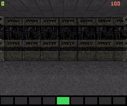
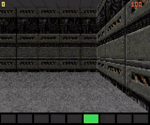
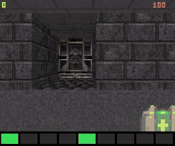
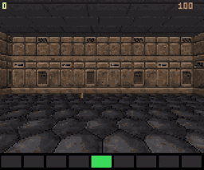
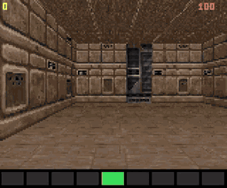

<div align="center">



<br>

[](https://www.python.org/)
[](https://pytorch.org/)
[](https://github.com/Farama-Foundation/ViZDoom)
[](https://gymnasium.farama.org/)
[](#-architecture)
[](#-architecture)

**Yugaantar 2026 · DevForge · Track 1 — *"Can It Play DOOM?"***

[Demo](#-watch-it-play) · [How it works](#-how-it-works) · [Architecture](#-architecture) · [Results](#-results) · [Ablations](#-ablations) · [Reproduce](#-reproduce) · [Brief (PDF)](docs/brief.pdf)

</div>

---

Reinforcement learning from scratch spends most of its budget discovering that walking forward is
useful. **Dooming Doom** skips that phase: a scripted **teacher** that is allowed to cheat during
training (it sees the floor plan and its true position) is distilled with **DAgger** into a
**sensor-only student** that plays unseen maps from the official observation alone. The student
is a small recurrent network with its own **spatial memory** and a tiny **RGB exit detector**: it reads
rays, visible entities, vitals and a 30×40 camera frame, never coordinates or ground truth.

<table>
<tr>
<td align="center"><b>77%</b><br><sub>exits on fresh maps</sub></td>
<td align="center"><b>78%</b><br><sub>red floor-pad exits</sub></td>
<td align="center"><b>80%</b><br><sub>key-door with backtracking</sub></td>
<td align="center"><b>85%</b><br><sub>combat arenas: fight, then leave</sub></td>
<td align="center"><b>20 / 20</b><br><sub>official sample map</sub></td>
</tr>
</table>

<sub>On 200 fresh maps never used for training or for choosing the checkpoint, played through the exact submitted
inference path. Paired against our previous rays-only submission: <b>+16 ± 8 points</b> of exits (95% CI).</sub>

## 🎮 Watch it play

<table>
<tr>
<td width="50%" align="center"><br><sub><b>Key-door:</b> meets the locked door first, finds the key, comes back</sub></td>
<td width="50%" align="center"><br><sub><b>Combat arena:</b> kills both enemies, then finds the exit</sub></td>
</tr>
<tr>
<td width="50%" align="center"><br><sub><b>Floor-pad exit:</b> spots the red exit pad on camera and walks onto it</sub></td>
<td width="50%" align="center"><br><sub><b>Gauntlet:</b> two keys, two locks, two enemies, red-pad exit</sub></td>
</tr>
</table>

<details>
<summary><b>Official <code>two_rooms.wad</code></b> (exits in 20 of 20 runs, 71 decisions on average)</summary>
<br>
<p align="center"></p>
</details>

<sub>The bar under each clip lights up the buttons pressed at each decision. The agent sees this frame only
pooled to 30×40 (for spotting exits), plus its sensors. Clips are from fresh maps, recorded with
<code>training/record.py</code>.</sub>

## 🧠 How it works

<p align="center"></p>

1. **Privileged teacher** ([`training/expert.py`](training/expert.py), training only). A scripted expert
   that may use the generated map's floor plan and its true position. Its *decisions* are kept
   imitable from sensors: it explores toward places its rays haven't swept, targets keys once seen and
   the exit once it has been **on camera**, fights and dodges what is visible, and presses USE once at a door.
2. **Sensor-only student** ([`submission/`](submission/)) is the agent that ships. It is a recurrent network that
   sees only the official observation plus a **dead-reckoned spatial map** of where it has been, what
   its rays have swept, and where it saw doors and locked doors. Rays and entities have no "exit" class,
   so a small **RGB exit detector** reads the camera frame pooled to 30×40.
3. **DAgger** ([`training/dagger.py`](training/dagger.py)). The student drives, the teacher labels every
   state it reaches (teacher share β annealed 0.5 → 0.1), and the network trains on whole episodes through
   the GRU. This teaches recovery from the student's *own* mistakes, which plain cloning never sees.
4. **RGB exit detector** ([`training/pretrain_rgb.py`](training/pretrain_rgb.py)). The RGB branch is first
   trained alone on teacher frames to answer "is the exit on screen, and in which quarter of the view?"
   (a training-only auxiliary head), then joins the network with zero fusion weights, so DAgger continues
   from the previous policy unchanged and learns when to trust it.
5. **Recurrent PPO fine-tuning** ([`training/finetune.py`](training/finetune.py)) with scorer-aligned rewards
   and a **count-based curiosity bonus** computed on the agent's own map. We measured it honestly:
   within our budget it *lowered* held-out exits (0.58 → 0.38), so the DAgger policy is what ships.

## 🔬 Architecture

<p align="center"></p>

| | |
|---|---|
| **Inputs** | Official observation only: 64 rays × 360° (circular Conv1d), up to 32 visible entities (masked attention + null token), vitals, previous buttons, elapsed time, the **RGB frame pooled to 30 × 40** (exit detector); plus the agent's own **spatial map** (4 × 24 × 24 heading-up crop: visited / swept / door / locked door). |
| **Network** | ray / entity / vitals / map / RGB encoders → fusion 256 → **GRU 256** → 16 macro-actions; **992,998 parameters** (exit and value heads are training-only) |
| **Actions** | 16 macro-actions over the 9 buttons ([`actions.py`](submission/doomnet/actions.py)): no contradictory combinations, so doors don't bounce from repeated USE |
| **Speed** | ~4.7 ms per decision on 1 CPU thread (budget: 40 ms) |
| **Submission** | [`submission/agent.py`](submission/agent.py) + [`submission/doomnet/`](submission/doomnet/) + `submission/weights/actor.pt` (Git LFS) |

## 📊 Results

<p align="center"></p>

<details>
<summary><b>Four-way comparison on the same 200 fresh maps</b></summary>

| Fresh maps (one episode each) | Previous submission (rays only) | RGB-only model | Longer-trained rays model | **Shipped (rays + map + RGB)** |
|---|---|---|---|---|
| **Exits, all 200 maps** | 0.61 | 0.66 | 0.645 | **0.77** |
| Red floor-pad exits (90 maps) | 0.48 | 0.66 | 0.51 | **0.78** |
| Alcove exits + combat (110 maps) | 0.72 | 0.66 | 0.75 | **0.76** |
| — multi-room / easy key / key-door / mixed | 0.90 / 1.00 / 0.70 / 0.63 | 0.60 / 0.90 / 0.63 / 0.60 | 0.75 / 1.00 / 0.83 / 0.77 | 0.75 / 1.00 / 0.80 / 0.60 |
| Combat arenas: exit after fighting | 0.55 | 0.75 | 0.50 | **0.85** |
| Kill fraction (maps with monsters) | 0.86 | 0.91 | 0.93 | **0.93** |
| Deaths (of 200) | 8 | 4 | 5 | **4** |
| Official `two_rooms.wad`, 20 runs | 20/20 · 105 steps | 20/20 · 162 | 20/20 · 171 | **20/20 · 71** |
| Proxy score | 111.9 | 117.9 | 118.2 | **129.7** |

Paired differences of the shipped model on all 200 maps (95% CI): **+16 ± 8 %** exits vs the previous
submission, **+11 ± 8 %** vs the RGB-only model, **+12.5 ± 8 %** vs the longer-trained rays model. The maps
(`confirm`, `confirmpad`) were never used for training or for choosing any checkpoint, and each map is
played once (on monster-free maps an episode is deterministic, so extra seeds would repeat it).
Its weakest family is the mixed gauntlet (0.60). More detail is in [training/README.md](training/README.md).
</details>

## 🧪 Ablations

<p align="center"></p>

- **The spatial map is the single biggest lever.** On identical teacher data, removing it costs 19 points of
  exits. The teacher's exploration decisions depend on where it has already looked, and the map is the only
  input that carries that information.
- **DAgger beats cloning by 34 points.** Cloning alone almost never finishes a key-door map: the
  find key → return → exit chain breaks at the first state the teacher never visited.
- **Sample, don't argmax.** Greedy action selection gets stuck in loops, and sampling escapes them.

Method, confidence intervals and reproduction commands are in [docs/ablations.md](docs/ablations.md). These ablations
were run on the rays + map recipe before the RGB branch was added; the RGB branch's own effect is the comparison above.

## ⚖️ Playing by the rules

> [!IMPORTANT]
> Every action at evaluation comes from the network. There are no rule trees, no search, and no
> `atan2` aiming in `submission/`. A test checks that `submission/` never imports `training/`.
> The teacher, its BFS planner, the auxiliary exit labels and all ground-truth rewards exist only at
> training time. The RGB frame is part of the official observation.

## 🚀 Reproduce

<details open>
<summary><b>Windows (PowerShell)</b></summary>

```powershell
uv sync --group train                                                            # torch, scipy, psutil, imageio-ffmpeg
.venv\Scripts\python.exe -m training.maps.gen --all                              # procedural map pools
.venv\Scripts\python.exe -m training.evaluate expert                             # teacher ceiling
.venv\Scripts\python.exe -m training.dagger --run il4 --workers 10                 # stage 1: DAgger
.venv\Scripts\python.exe -m training.finetune --init runs\il4\best.pt --run ppo   # stage 2: PPO (optional)
.venv\Scripts\python.exe -m training.evaluate runs\il4\best.pt                   # held-out maps
.venv\Scripts\python.exe -m training.watch --run il4                             # live viewer
.venv\Scripts\python.exe -m training.record submission\weights\actor.pt --wad maps\two_rooms.wad   # demo video
.venv\Scripts\python.exe -m pytest -q tests
python validate.py
```
</details>

<details>
<summary><b>Recipe for the shipped weights</b></summary>

```powershell
# 1. rays + map student: a longer DAgger run on a second machine (same trainer; its exact flags were not
#    recorded) -> runs/best.pt (iteration 17, rays + map, 920k params). For example:
python -m training.dagger --run il --workers 10 --iters 30
# 2. RGB exit detector pre-trained on teacher frames (red GATE3 pads, random textures), rest of the network frozen
python -m training.pretrain_rgb --init runs/best.pt --out runs/rgbpre_best.pt --frames 90000 --val-frames 20000 --epochs 12 --workers 10
# 3. DAgger continues with the RGB branch (zero fusion weights at start) -> runs/rgb_best/iter03.pt = shipped
python -m training.dagger --run rgb_best --init runs/rgbpre_best.pt --workers 10 --iters 12 --steps 80000 --updates 300     --batch-steps 8192 --cap 1000000 --lr 1e-4 --aux 0.5 --aux-pos-weight 10 --beta 0.3 0.1 --pools train train2
```
</details>

## 🗂️ Repository layout

```
submission/            the evaluated agent
  agent.py               DoomAgent: the evaluation entry point
  doomnet/               observation adapter + spatial map + RGB pooling, macro-actions, policy network
  weights/actor.pt       shipped weights (Git LFS)
training/              training-time only (never imported by submission/)
  expert.py              privileged teacher
  dagger.py              DAgger trainer        finetune.py   recurrent PPO
  pretrain_rgb.py        RGB exit-detector pre-training
  maps/                  UDMF map generator: combat, rooms, key-door A/B/C, gauntlets, floor-pad exits
  evaluate.py            held-out evaluation with a proxy of the official score
  record.py / watch.py   demo videos / live viewer
env/                   official ViZDoom Gymnasium wrapper (doom_env)
tests/                 wrapper, validator, policy, adapter and reward tests
docs/                  brief, ablations, contract, rules, evaluation, submission guide
```

## 📚 Documentation

| Doc | What's inside |
| --- | --- |
| [docs/brief.pdf](docs/brief.pdf) | Two-page project brief |
| [training/README.md](training/README.md) | Training pipeline, teacher details, full results |
| [docs/ablations.md](docs/ablations.md) | Spatial map, DAgger vs BC, action selection, snapshot choice, PPO |
| [docs/CONTRACT.md](docs/CONTRACT.md) | Observation/action spaces and the `DoomAgent` interface |
| [docs/RULES.md](docs/RULES.md) | Ground rules: what's allowed, what gets you disqualified |
| [docs/EVALUATION.md](docs/EVALUATION.md) | Map tiers, scoring categories, timeouts, replays |
| [docs/SUBMISSION.md](docs/SUBMISSION.md) | Submission checklist, Git LFS, size limit, `requirements.txt` |

<details>
<summary><b>Original template documentation</b></summary>

Built during the event from the official template
([`Reinforce-SST/devforge-doom-template`](https://github.com/Reinforce-SST/devforge-doom-template) @ `63b90c4`,
contract `1.0.0-draft`).

> For decades, *"Can it run DOOM?"* was the ultimate hardware test. Now: **can your neural network
> actually play DOOM?** Train an agent that plays unseen levels **zero-shot**: survive ambushes,
> navigate multi-room layouts, find keycards, unlock doors and reach the exit.

No dataset is provided. Your agent learns by interacting with the engine.

### Quickstart

1. Click **"Use this template"** on GitHub to create your team's (public) repository.
2. Set up the environment (Python 3.13, [uv](https://docs.astral.sh/uv/)):

   ```bash
   uv sync                 # installs vizdoom, gymnasium and the official wrapper (env/) in editable mode
   uv run python validate.py
   ```

   Or use the official image, which is exactly what the scorer runs:

   ```bash
   docker build -t devforge-doom .            # or: docker pull <official image tag, announced>
   python validate.py --docker --image devforge-doom   # installs requirements.txt, then runs sandboxed like the scorer
   ```

3. Replace the random baseline in `submission/agent.py` with your trained agent.
4. Put weights in `submission/weights/` (Git LFS) and training code in `training/`.
5. Run `python validate.py --docker` and submit your repo URL.

**Platforms:** Linux (x86-64/ARM), macOS on Apple Silicon (macOS 15+) and Windows (x86-64) all
work with `uv sync` and `validate.py`. Intel Macs have no `vizdoom` 1.3.3 wheel: use Docker or a
Linux machine. Evaluation runs on Linux, so `validate.py --docker` is the closest check.

### Using the environment

```python
from doom_env import make_env

env = make_env("maps/two_rooms.wad")     # test map; use your own maps for training
obs, info = env.reset(seed=0)
obs, reward, terminated, truncated, info = env.step(env.action_space.sample())
```

Observations are a dict of `rgb`, `depth`, `vitals`, `rays` and `visible_entities`, all
ego-centric and partially observable. See [docs/CONTRACT.md](docs/CONTRACT.md).
The wrapper's `reward` is a basic default for convenience. Shape your own reward for training.

**Compute tip:** training only on raw pixels is expensive. The `rays`, `visible_entities` and
`vitals` signals run thousands of steps per second on a CPU. Hybrid pixel + spatial models are welcome.

### Hardware at evaluation

One NVIDIA **RTX 3090 (24 GB)** shared between evaluation workers. Each agent gets **2 GB VRAM,
8 GB RAM and 1 CPU thread**, so keep models compact and inference fast
(see [hardware](docs/EVALUATION.md#hardware) and [timeouts](docs/EVALUATION.md#timeouts)).
`validate.py` runs your agent under the same CPU/RAM limits and reports GPU memory.

### Rules in one minute

- Actions must come from **trained neural parameters**: no rule trees, no `A*`/Dijkstra, no `atan2` aimbots,
  no unmodified off-the-shelf SB3.
- Change anything you want **during training**. Evaluation uses the **vanilla engine**, the
  official wrapper and **unseen maps**.
- Create the repo during the hackathon. Libraries are fine; the core architecture and training must be yours.

</details>

<div align="center">
<br>
<sub>Built during Yugaantar 2026 · DevForge. DOOM assets via <a href="https://freedoom.github.io/">Freedoom</a> and <a href="https://github.com/Farama-Foundation/ViZDoom">ViZDoom</a>.</sub>
</div>
